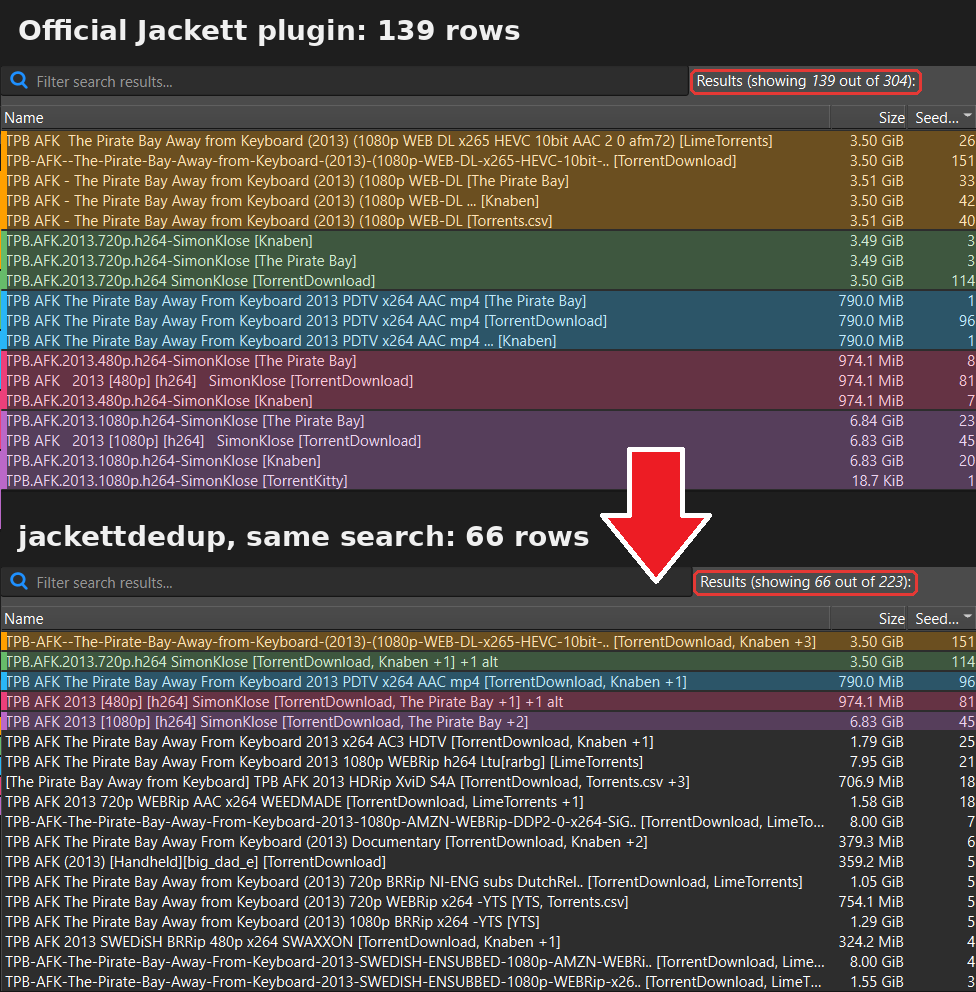
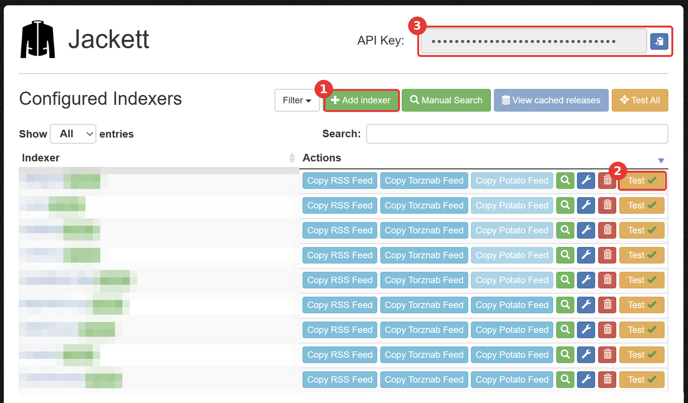
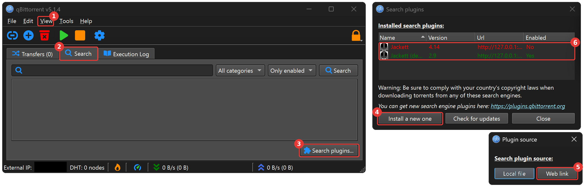
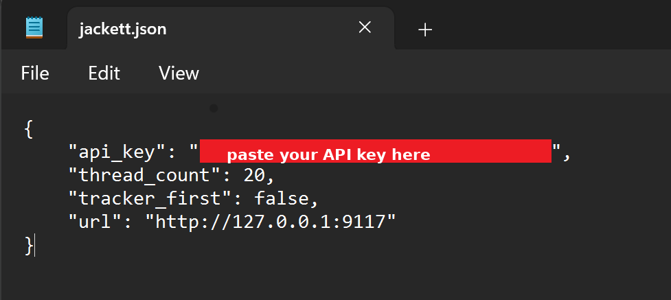
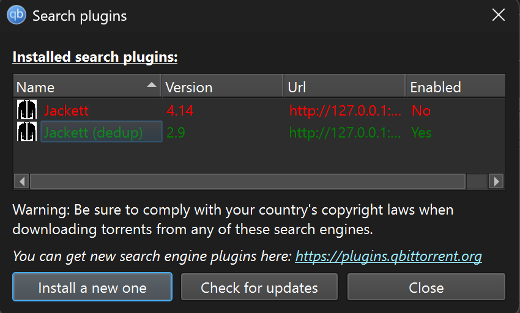

# jackettdedup

> [!IMPORTANT]
> Use the plugins and the websites they connect to at your own risk. \
> You are personally responsible for following the copyright laws and other applicable laws in your country.

TL;DR- A search plugin for qBittorrent. It merges Jackett's duplicate search results (the same torrent listed by several sites) into one row.

ELI5- searching a torrent means checking across TPB, 1337x, BtDigg, etc. With qBittorrent's built-in Jackett plugin (setup guide below), all these sites are searched within qBittorrent itself and put in one list. But, if the same torrent was uploaded to five sites, you get five rows for the same thing. My plugin collapses these 5 results into one row and pools the sites' trackers into one link so you find more peers- this makes searching easier and your downloads faster. It also hides (can toggle off) torrents with matching title+size but different infohash with fewer seeders. These are different torrents that can't be merged (usually a re-upload with minor changes); the best-seeded one is kept and the rest are hidden behind a `+N alt` marker. [Details](#details) below.



## Contents

- [Install](#install)
  - [1. Jackett](#1-jackett)
  - [2. qBittorrent](#2-qbittorrent)
  - [3. Setup Jackett API key](#3-setup-jackett-api-key)
  - [4. Setup my search deduper](#4-setup-my-search-deduper)
- [Settings](#settings)
- [Details](#details)
  - [Merging](#merging)
  - [Hash lookups](#hash-lookups)
  - [Lookalikes](#lookalikes)
  - [Which sites to keep in Jackett](#which-sites-to-keep-in-jackett)
- [Beyond deduping](#beyond-deduping)
- [What it doesn't do](#what-it-doesnt-do)
- [Tests](#tests)
- [Credits and license](#credits-and-license)
- [Support](#support)

## Install

Already running Jackett with qBittorrent's official Jackett plugin, and getting results? Skip to [step 4](#4-setup-my-search-deduper).

### 1. Jackett

Jackett is an open source program that searches multiple torrent sites for Qbittorrent. It only spins up when it searches; and otherwise winds back down.

1. Download and run the installer from [Jackett releases](https://github.com/Jackett/Jackett/releases).
2. Tick **Install as a Windows Service**, so Jackett starts with Windows; searches fail whenever it isn't running.
3. Open http://127.0.0.1:9117 (or double-click the Jackett tray icon). 
4. Click **Add indexer** and add the sites you want (1). Each site gets a Test button (2); a red one is broken on Jackett's side (site down, Cloudflare, your ISP or VPN blocking it), consider disabling/ deleting them.
5. Copy the **API Key** from the top right (3).




### 2. qBittorrent

1. Install [qBittorrent](https://www.qbittorrent.org/download)
2. Enable the search tab: **View** (1) **→ Search Engine**. qBittorrent offers to install Python; install it if you don't have it.
3. In the **Search** tab (2), click **Search plugins...** (3), then **Install a new one** (4) **→ Web link** (5) and paste
```
https://raw.githubusercontent.com/qbittorrent/search-plugins/master/nova3/engines/jackett.py
```




### 3. Setup Jackett API key

1. Open the Jackett settings file (`Win + R`):
```
notepad "%LOCALAPPDATA%\qBittorrent\nova3\engines\jackett.json"
```
Linux: `~/.local/share/qBittorrent/nova3/engines/`;
macOS: `~/Library/Application Support/qBittorrent/nova3/engines/`;

2. Replace `YOUR_API_KEY_HERE` with the key from Step 1.4 and save. 



3. Search for something in qBittorrent's Search tab. Results mean Jackett is set up. A single row reading `Jackett: api key error` means the key wasn't saved; a `connection error` means Jackett isn't running (check the tray icon). Some sites return nothing or fail depending on your ISP, VPN, or the site not playing nice with Jackett (anecdotally, 1337x). That is normal, and it is between Jackett and the site.

### 4. Setup my search deduper

1. Download `jackettdedup.py` from this repo.
2. qBittorrent -> `Search` Tab -> `Search Plugins` -> right-click `Jackett` -> untick `Enabled`. Disable it, don't uninstall it.  
3. `Search Plugins` -> `Install a new one` -> `Local File` -> Pick `jackettdedup.py`
4. Search again. Results appear within about 20 seconds; slow sites add theirs after that. If you add more sites to Jackett (http://127.0.0.1:9117); these are picked up automatically.


## Settings
Everything is in `jackettdedup.json`, it's read at the start of every search, so edits need no restart. To tweak `(Win + R)`:
```
notepad "%LOCALAPPDATA%\qBittorrent\nova3\engines\jackettdedup.json"
```
Every setting is explained above its default in `jackettdedup.py`. The ones most people touch:

| Setting | Default | What it does |
|---|---|---|
| `show_results_after` | `20` | Seconds until the first results are shown. Lower is faster but shows more duplicates. |
| `max_search_time` | `60` | Seconds until the search ends. Rows with unresolved hashes are shown unmerged at this time |
| `lookup_per_indexer` | `4` | Hash lookups running at the same time on one site. `1` or `2` for sites behind Cloudflare or FlareSolverr. |
| `lookup_remaining_hashes` | `true` | After the likely duplicates, look up every other hash-less row too while waiting for `show_results_after`. `false` looks up likely duplicates only. |
| `search_retries` | `3` | Extra attempts when a site's search fails inside Jackett; such failures often clear on the second try. |
| `fold_lookalikes` | `true` | Hide re-uploads behind `+N alt`. `false` shows every distinct torrent. |
| `debug_log` | `false` | Write `jackettdedup.log` next to the plugin: what each search did, and why any row couldn't be merged. |

## Details

### Merging

The infohash is a hash of the torrent's file list, sizes and piece checksums, so two rows with the same infohash are the same. Merging them loses nothing; and this increases the number of seeders you connect to by pooling together swarms from different sites. The merged row takes the highest seed count any site reported and a magnet link with every site's trackers.

qBittorrent lets a plugin add rows but never change or remove one, so a row is built from the copies in hand when it is shown. A copy that arrives later (a slow site, a lookup that finished after the deadline) is dropped rather than shown twice; it cannot raise the seed count of a row already on screen. Results wait `show_results_after` seconds so that most copies are in by then.

### Hash lookups

1337x, LimeTorrents, TorrentDownloads, Torrent9 and some others only give Jackett a link to the torrent's page, so their rows arrive without an infohash. For each such row that looks like a possible duplicate (similar size and title to a row from another site), the plugin fetches the row's download link from Jackett, which returns the magnet or the `.torrent` file, and reads the hash from it. Then it merges normally.

Each lookup is one page fetch on the site, so it is limited: public sites only (on private trackers; this may count against your account), and nothing is kept between searches. A row whose site reports no size takes its size from the `.torrent` the lookup returns. A row whose lookup hasn't finished by `max_search_time` is shown unmerged, not dropped.

Lookups run in two rounds. Likely duplicates go first and are held until their lookup finishes. Then, with whatever time is left before `show_results_after`, every other hash-less row is looked up too (`lookup_remaining_hashes`), one slot per site always kept free for a likely duplicate that arrives late. This second round catches copies whose titles are too different to look alike, such as a DHT site's file name against a release name, and it is how a row from a site that reports no seeders ends up with a seed count: once its hash is known it merges into the copy that has one. A second-round row whose lookup hasn't finished at `show_results_after` is shown as it is; the search does not wait for it.

### Lookalikes

Two rows with the same torrent title (ignoring site tags like `[TGx]`, brackets and punctuation), the same size and *different* infohashes are almost always the same files uploaded twice: a renamed folder, an extra text file, or a tracker's own keys inside the torrent. They are separate swarms, so they can't be merged; the best-seeded one is shown with `+N alt` and the rest are hidden. 

Titles that differ by a real word never fold, because those are different videos:

| You see | Why |
|---|---|
| `Name (2018) 720p BRRip x264 -YTS`<br>`Name (2018) 720p WEBRip x264 -YTS` | Different source material. YTS encodes to fixed sizes, so the sizes match by design. |
| `Name [2018, WEB-DL-AVC] Dub`<br>`Name [2018, BDRip] Dub` | Different encodes, from Russian trackers that also put their own keys inside every torrent. |

### Which sites to keep in Jackett

Fewer sites means faster searches, since each hash-less row may cost a page fetch.

- **Reports hashes:** The Pirate Bay, YTS, EZTV, Nyaa, TheRARBG, Knaben, Kickass clones, ExtraTorrent, Uindex, AnimeTosho.
- **One lookup per row:** 1337x, LimeTorrents, Torrent Downloads, TorrentDownload, TorrentProject2, Torrent[CORE], Magnetz, TorrentGalaxyClone, Torrent9, most adult sites.
- **Rarely add anything:** meta-search engines and DHT crawlers (Magnetz, TorrentDownload, TorrentProject2, Torrent[CORE], TorrentByte) mostly re-list what the sites above already have, at a lookup per row.

## Beyond deduping

Things the official Jackett plugin leaves alone, handled here:

| | Official plugin | jackettdedup |
|---|---|---|
| A site fails inside Jackett (Cloudflare challenge, site hiccup) | One row saying "connection error", even though Jackett is fine | Asked again, up to `search_retries` times, 2 s apart; most such failures clear on the second try. If it still fails, the error row carries Jackett's own message, e.g. `Exception (1337x): Cloudflare challenge failed` |
| Sites that report no seeders | Their rows show no seed count, so most people skip them | Their hash is looked up and the row merges into the copy that has a seed count, which the merged row shows |
| Copies with very different names (a DHT site's file name vs. the release name) | Separate rows | Merged if the lookup after similar names has fetched a matching hash |
| A title with a line break in it | A garbage row named after the size (`536870912`) | One normal row |
| A `\|` in a title | Shows as `%7C` | Shows as it should |
| The download link answers with an error page | Saved as a `.torrent`; the download fails later | Reported as a failed download right away |
| Downloading a row | Fetches the link twice | Once |

## What it doesn't do

- Never merges by name or size. A different infohash is a different torrent
- qBittorrent only lets a plugin add rows. We can't change a row once it's on screen; late copies are dropped vs. shown twice.
- Doesn't search anything Jackett doesn't. No new sites, and no fixing a site that is red in Jackett.
- Only touches Jackett's results. Rows from other plugins are shown by qBittorrent as they come, duplicates included.
- Never fetches anything from a private or semi-private tracker; those rows are shown as they arrive and are never folded.
- Keeps nothing between searches: no cache, no history, no files written other than its settings.
- Doesn't catch every duplicate. A copy that arrives after its row was shown, a lookup that fails or runs past `max_search_time`, or a site that reports neither a hash nor a download link, stays as its own row.
- Jackett only; Prowlarr has a different API and is not supported.

## Tests

```
python tests/test_jackettdedup.py
```

Offline; a local web server plays the part of Jackett.

## Credits and license

The plugin replaces the official Jackett plugin rather than running on top of it: qBittorrent runs this file, which talks to Jackett itself. The parts that talk to Jackett and qBittorrent (API calls, category ids, error row, proxy handling) follow the official `jackett.py` by Diego de las Heras and contributors, from [qbittorrent/search-plugins](https://github.com/qbittorrent/search-plugins); the merging is new. GPL-2.0-or-later, like the plugin it borrows from.

## Support

If you'd like to support me; 
 - Venmo: Arihan-Jalan
 - BuyMeACoffee: https://buymeacoffee.com/arihan
 - Paypal: https://paypal.me/arihanjalan
 - GPay: jalanarihan@oksbi
